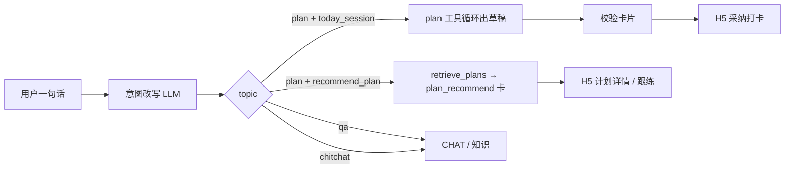
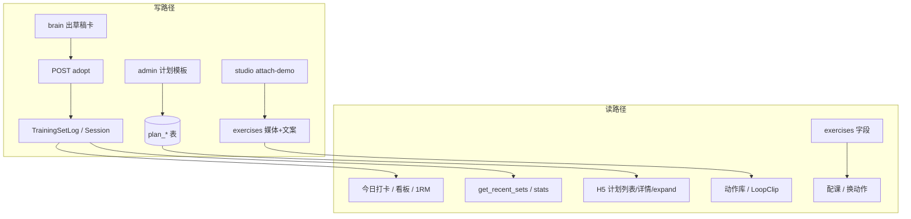

# GymCoach 项目地图

> **唯一台账**（Obsidian 打开本文件即可）。Agent 入口见仓库根 `AGENTS.md`。  
> 加功能就改这一页；有跨模块影响再改 **§8 耦合表**。不要再拆多份 md。  
> 范围：本仓 H5 + API。后台 UI 在 `gym-coach-admin`，本 API 的 `/api/admin` 仍记在下面。  
> 评测用例在仓库根目录 `eval/`，不进本文。

---

## 1. 做什么 / 不做什么

**做**：对话出今日计划 → 采纳打卡 → 记录回流；动作库；训练看板；计划模板（H5 浏览 + 后台配置）。

**暂不做**：营养记录/agent、周历排课、用户自建计划、成就皮肤、Vision 纠错、prompt 热更新后台。

---

## 2. 能力一览

| 能力 | 怎么触发 | 状态 |
|---|---|---|
| 出计划 plan | 「今天练胸」等；`plan_kind=today_session` | ✅ |
| 荐模板 plan | 「帮我找个三分化」等；`plan_kind=recommend_plan` → `plan_recommend` 卡 | ✅ |
| 问答 qa | 动作怎么做 / 建议 / 查自己的数 | ✅ |
| 闲聊 chitchat | 寒暄、不想练 | ✅ |
| 安全停训 | 带伤问练 | ✅ |
| 今日打卡 + 计时 + 1RM | 今日页；有跟练时采纳草稿二次确认；**已完成可 `append_today` 再开一场**（保留历史）；未完成再采纳则覆盖并二次确认 | ✅ |
| 训练 Tab 部位热力 | `/training` 全身热力 → `/exercises?muscle=` | ✅ |
| 动作库浏览 | `/exercises`；详情页示范下发力肌群示意 | ✅ |
| 计划模板 H5 | `/plans` → 详情预填动作 → 选板块 expand → adopt | ✅ |
| 计划模板后台 | admin「计划模板」 | ✅ |
| 营养 | — | 📋 未做 |
| 打卡海报 / 生图 | — | 💡 规划中 |
| 复盘 AI 文案 | Recap 页 | 📋 未做（工单 Phase4 可选） |

---

## 3. 意图怎么走

代码：`api/app/brain/intent_rewrite.py` → `graph.py`

**一级 topic（模型分）**

| topic | 含义 | 接着谁处理 |
|---|---|---|
| `plan` | 要一份安排（训练/饮食） | 排课路径；再看 `plan_kind` |
| `qa` | 解释、建议、查数据 | 聊天/知识 |
| `chitchat` | 都不要 | 聊天短路 |

另有 `domain`：`training | nutrition | general`（只标领域）。  
`qa` 还可带 `qa_kind`：`explain | recall | decide`。  
`plan` 还可带 `plan_kind`：`today_session`（默认，出今日草稿）| `recommend_plan`（荐模板，走 `retrieve_plans`）。

**图路由** `_pick_route`：`clarify | plan | recommend | chat | nutrition`（nutrition 仍是占位）。



---

## 4. 模型工具

白名单：`brain/tools.py` → `execute_tool`

| 工具 | 干什么 |
|---|---|
| `retrieve_exercises` | 按部位等取候选动作 |
| `retrieve_plans` | 按场景/分化/天数筛已发布模板（荐计划） |
| `get_related_stats` | 读相关历史重量（含体感/表现/估1RM） |
| `get_recent_sets` | 读近期组记录 |
| `submit_training_draft` | 提交草稿结构（不落库） |

落库靠 HTTP：`POST /api/training/adopt` 等，**不是**模型工具。

排课检索核心还有内存目录：`exercises_catalog.retrieve_candidates`；荐模板见 `brain/plan_recommend.py`。

---

## 5. Prompt 在哪

没有单独 `prompts/` 目录，正文在代码里：

| 名字 | 文件 |
|---|---|
| 意图槽位提取 | `brain/intent_rewrite.py` |
| PLAN 兜底出卡 | `brain/pipeline.py` → `SYSTEM_PROMPT` |
| CHAT 问答 | `brain/pipeline.py` → `CHAT_SYSTEM` |
| 工具循环 | `brain/plan_loop.py` → `PLAN_TOOL_SYSTEM` |
| 知识问答 | `brain/knowledge_reply.py` → `KNOWLEDGE_SYSTEM` |

红线：不编造库外动作；称呼用「你」；伤病要规避；模型改不了系统提示词。

---

## 6. 关键数据口径

| 点 | 事实 |
|---|---|
| 打卡动作键 | `TrainingSetLog.exercise_name`（中文名）+ **`exercise_id` 双写**（新记录有则填；热力/`muscle_pulse` 优先按 id 聚合） |
| 动作库 SKU | `exercises.id`；`roles`=肌群，`slot_roles`=计划槽位，勿混；详情 API 另出 `secondary_muscles_zh`（roles 去主练） |
| 女版呈现 | **示范/要点跟计划走**：工坊默认写 `plan_exercises.demo_*` + `cues_zh`/`common_mistakes_zh`，不盖总库。需要沉淀总库时再显式「写入动作库」或派生 `{原名}·女`（`variant_of`↔`female_variant`）。`scene_tag=女性专项` 可照常绑通用 SKU 切片 |
| 计划模板 | `plan_templates` → `plan_blocks` → `plan_exercises`；未发布不进 H5；框架空槽在 `GET /plans/{id}` 预填动作名（`preview_filled`），不展示空壳槽位 |
| 计划场景标签 | `plan_templates.scene_tag`：人群/场景分组（热门计划/女性专项/新手入门/进阶强化/居家训练/增肌专项/减脂塑形/博主同款）；分化写标题或 `split_summary`；H5 `/plans` 按 tag 分组，组内封面卡横向滑动 |
| 计划库列表卡 | 信息全在封面上（对齐设计稿 16）：磨砂角标 `badge_label`（占位词如「框架」不展示）+ 大标题 + 部位/`每周 N 练` 描边小 chip（单板块=`当日练`）；不贴 scene 小标、不在卡外再挂一行 |
| 动作行目标肌群 | `plan_exercises.target_muscle`（胸/背/肩/腿/臂/核心）；拆解溯源用 `source_kind` / `match_confidence` / `source_snippet`，**勿塞 `note`** |
| 组间休息 | `plan_exercises.rest_sec`（默认 90） |
| 勾选时刻 | `trainingsetlog.completed_at`（组间休息/视频分析用；历史可空） |
| 跟练进度 | `profile.active_plan_id` + `active_plan_started_at`；`GET /plans/following`：**多板块**按滚动一轮（三分化=3 场、五分化=5 场；不按自然周重置、不要求连续天），**单板块/当日练**只服务当天：当天完成=`今日已完成`，**隔日自动清跟练指针**（无进行中计划，需重选）；字段名仍为 `week`/`week_cycle_done`（兼容），语义是当前轮。自然周仅 dashboard「本周练了几天」。退出跟练只清指针，历史场次保留 |
| 休息建议 | 软提示不锁死：大肌群间隔约 3 天、小肌群约 2 天、核心可每天；跟练中也可 `POST /rest-today`。工坊并入计划用计划选择器（非手填 ID） |
| 内容工坊任务 | 表 `studio_tasks` + `/api/admin/studio/*` + Admin `/studio`（本地上传可跑通；链接需 yt-dlp；字幕可选 faster-whisper）；发布可新建或并入已有计划（选择器），多视频可「合成一套分化」 |
| 场次溯源 | `trainingsession.plan_template_id / plan_block_id / plan_type` |
| 场次约热量 | 今日完成态第三格：粗估 `MET≈5 × weight_kg × 小时`（前端 `estimateSessionKcal`）；正式按 modality/METs 入库另做。缺体重或时长则显示 — |
| 热身组 | `trainingsetlog.is_warmup`，不计入 1RM |
| 默认库文件 | SQLite：`api/data/gym.db`（`DATABASE_URL=sqlite:///./data/gym.db`）；启动 `init_db` 自动 `create_all` + `_ensure_columns` 补列 |
| 会话助手轮轨迹 | `ChatTurn.trace_id` → `DebugTrace.id`；刷新后 H5 仍可点赞踩 |
| 回复反馈 | 教练气泡默认显示点赞/踩（有 `trace_id`/`turn_id` 时）；点踩标签含 `multi_turn_lost` / `multi_intent_miss`；差评导出 `api/scripts/export_feedback_inbox.py --format auto\|single\|thread` |

### 6.1 配课 / 换动作判定标准（字段优先，禁止动作名写死）

**原则**：运行时只信结构化字段；加新动作 = 后台填字段，**不改**配课代码。

| 用途 | 信什么 | 不信什么 |
|---|---|---|
| 是否核心动作 | `muscle==核心` 或 `movement_pattern==核心卷曲/稳定` | 名字含「平板/卷腹…」 |
| 槽位 main/assist/isolation | `slot_roles`（有则用之）；空则用 `movement_pattern`+`muscle`+`modality` 推断 | 名字含「夹胸/飞鸟…」 |
| 抽哪块肌 | `PlanExercise.target_muscle`；换动作优先 `item.muscle` 主练一致 | 把 `roles` 协同与主练等权 |
| 推日/拉日「臂」 | `sub_region` 含 `肱三头肌` / `肱二头肌` | 名字含「弯举/下压」长期名单 |

**脏数据怎么治**：去后台改该动作的 `muscle` / `movement_pattern` / `slot_roles` / `sub_region`。名字启发只允许出现在后台「猜分类」工具（`admin_editor._guess_taxonomy`），用来一次性填字段，不是热路径规则。

**AI 补全分类**：`admin_editor.ai_draft` + `_guess_taxonomy`；`movement_pattern` 必须落在枚举；猜不出就**留空 + needs_review**，禁止用「全身心肺/综合」给抗阻凑数。别名含下压/下拉→垂直拉、划船→水平拉等。

**热身入库（不另建库）**：同一 `exercises` 表；`slot_roles` 含 `warmup`，`modality` 用「灵活性」（拉伸可用 pattern「拉伸/灵活」）；计划里热身块/行只抽这类。一次性热身/动作可工坊**不绑 SKU**：只要有动作名即可进计划；口播要点写 `plan_exercises.cues_zh` / `common_mistakes_zh`（跟计划走），不必进总库。

**夹胸/飞鸟/腿屈伸等孤立**：taxonomy 里若暂无专属 `movement_pattern`，必须在动作上标 `slot_roles=["isolation"]`，勿在 API 里加动作名黑白名单。

**公司机拉代码后怎么看库（可选）**

```bash
cd api
# 启动一次 API 就会自动补列 / 建 studio_tasks
.\.venv\Scripts\python.exe -c "from app.db import init_db; init_db(); print('ok')"
# 只看表结构（SQLite）
.\.venv\Scripts\python.exe -c "from sqlalchemy import inspect; from app.db import engine; i=inspect(engine); print(i.get_table_names()); print([c['name'] for c in i.get_columns('plan_exercises')])"
```

也可用 [DB Browser for SQLite](https://sqlitebrowser.org/) 打开 `api/data/gym.db`。Postgres 则连 `.env` 里的 `DATABASE_URL`。

---

## 7. 主要接口（记目录）

- 对话：`/api/chat*` · 评测：`/api/eval/*` · 反馈：`/api/feedback`
- 训练：`/api/training/today|adopt|sets|dashboard|sessions…`；`adopt` 支持 `append_today`（保留今日 done 新开 active）/ `force_replace_done`（作废 done 重开）/ 默认 `replace_today`（先 abandon 未完成 active）；`GET /today` **优先最新 active**，否则最新 done
- 动作库：`/api/exercises*`（列表 query：`q` / `muscle` / `gear` / `modality` / `coach_core`；列表项含 `modality`）
- 计划：`GET /api/plans`（`scene` 场景筛）· `GET /api/plans/{id}` · `POST …/expand` · `POST …/follow` · `DELETE /api/plans/follow` · `GET /api/plans/following`
- 画像/登录：`/api/profile*` · `/api/auth*`
- 后台：`/api/admin/exercises*` · `media-pool*` · `plans*` · `POST …/plans/{id}/cover` · `POST …/plan-blocks/{id}/cover`
- AI Ops：`/api/admin/ai-ops/misses*`（聚合未命中 / AI 判别 / 绑别名热重载 / resolve）· `/api/admin/ai-ops/feedbacks*`（差评列表 / 诊断 / 导出 inbox / 忽略）· `GET …/plan-gaps`（荐计划 0 命中缺口）· `POST …/aliases`（工坊口播词补别名）
- 内容工坊：`/api/admin/studio/ingest-batch|tasks*|upload-fallback|retry-download|replace-source|continue|retranscribe|skip-transcribe|reparse|attach-demo|attach-highlight|cover|preview-clip|quick-create-exercise|derive-female-variant|confirm-plan|cookies|deps`；`DELETE /tasks/{id}` 删任务（清本地视频，已发布计划不回滚）；工作台右栏「重跑字幕」+「重新拆动作」（`attach-demo` 立刻写示范；`attach-highlight` 立刻写带声教学；`reparse` 按现有字幕重拆）；女计划可「派生女版」再切片
- 动作库：`POST /api/admin/exercises/{id}/derive-female` 从男版派生女版（拷贝分类/可选要领，不拷贝 demo）
- 工坊转字幕：进度随「已转到 mm:ss / 总时长」推进；默认 `faster-whisper` **small** + **CPU**（`STUDIO_WHISPER_MODEL` / `STUDIO_WHISPER_DEVICE=cuda` 可改）；下载超时默认 `HF_ENDPOINT=hf-mirror.com`；型号失败回退 **base**；`beam_size/best_of=5`；转写后强制简体；**不做**错词白名单。卡住可 `skip-transcribe`
- 工坊拆课质量：字幕喂 `[#idx mm:ss]`；LLM 出 `scene`（`example/recall/intro` 丢弃，`warmup` 保留）+ `evidence_seg`；草稿行挂 `evidence` / `suspect`（与灯色独立）；**默认按句号取锚点**，子串重扫仅降级；抽取 prompt **不**再喂库名词表；同名合并仅 ≤45s 窗、teach score 无末尾时间偏置。听错纠名只作兜底：对照等长库名/别名 + 听混字符族，**唯一**命中才改；拆课禁止只凭姿势词硬套库名。Admin：`no_teach_clue`（闲聊提及）**默认折叠**可一键移除；「本次产出」可清除误切示范；展示支撑原话 +「只看可疑」
- 动作 SKU 列表：`GET /api/admin/exercises?sort=updated_desc|name|core`（默认按最新更新）
- 存储：`STORAGE_BACKEND=local|s3`（`api/app/services/storage.py`，默认本地 `/static/{key}`）
- 媒体 URL：`admin_catalog.media_url` 对已是 `/static/…` 的路径原样返回（勿再拼 `/static/exercises/`，否则 H5 示范/封面 404）
- 工坊 `attach-demo`：精确裁切（`-ss` 在 `-i` 后）。**计划模式默认只挂草稿/计划行**（`plan_exercises.demo_url` / `demo_cover_url`），**不盖**动作库 SKU；`write_to_library=true` 或「动作素材」模式才写入 published `demo`。Admin「做成示范」按行判断：未绑/失效不可写库；已绑分 **挂本计划** / **补进库** / **替换库示范**（看 SKU 是否已有 demo）。已切未入库：抽屉内「示范同步进库」。打开任务时 scrub 已删/换号的 `exercise_id`（清绑定并标 `sku_missing`，避免假已绑却写库 404）。封面取切片第 0 帧；**每次新文件名**；请求可带 `row_id` 写回草稿；前端钉住本次 URL；旧草稿仅在 **demo 与 cover 都缺** 时才用 SKU `image_start` 回填。H5 计划详情/expand 缩略图：**计划行示范优先**，缺再回落 SKU。选区总览换位置；微调约 28%
- 工坊 `attach-highlight`（双轨）：`5～180s` 带声切片（`-c:a aac -b:a 64k -ac 1`，无 `-an`），写入 published `highlight_video`，**不覆盖** `demo`；草稿另记 `highlight_url` / `highlight_cover_url`。Admin「做成教学视频」默认可写库；选区可按动作锚点自动拉到下一条前（上限 120s）。H5：`ExerciseRefCards` **教学优先**（controls 有声点播）；详情页顶框仍 **demo 优先**，正文折叠展开教学视频；仅有 highlight 无 demo 时顶框兜底
- 工坊要领：**发布即带入口播要点到本计划**，**不必**逐个开抽屉；**默认不盖动作库**。抽屉分段：**本计划** / **写入库**；默认本计划只编口播文案；点「写入库」才展开 SKU 选择与库内对照（未绑也可停在写入库以便选 SKU，勿强制打回本计划）。打开抽屉先展示口播抽出，配对用局部 loading。示范标：**本计划已切** / **SKU已有** / **待切**。H5：计划行要点优先。计划发布：未绑库有名可过；素材模式必须绑库
- 工坊发布后：`review_state=published` + `result_ref.plan_id`；队列文案「已发布」；可发布未点时显示「可发布」不再谎称「待审核」；**已发布计划名以 `PlanTemplate.title` 为准**（列表/详情叠回草稿；存草稿不冲掉 `review_state`，也不用发布前短名盖改过的计划名）；重拆/流水线结束保留已有 `plan_title` 与已发布态；队列副行带源文件名，避免多条任务 LLM 同名难辨
- 工坊多日分化：发布去向三选一——**新建一套** / **并入已有**（挂板块）/ **多条合成**（勾选队列其它可发布任务 + 填新计划名，一次收成多板块）。ingest 勾「合成一套分化」仍走 batch `plan_merge`。勿把推/拉/腿各发成独立计划
- SKU 详情「删除此素材」= 归档槽位（删动图会带走工坊同源封面）；「保存字段」只存文案/分类；「从 H5 下架」= `is_valid_exercise=false`（H5 搜不到，后台可再上架）
- SKU 列表「删除」= `DELETE /api/admin/exercises/{id}` 硬删（清别名/素材；计划行解绑保留动作名）；列表筛去掉「素材状态」
- 工坊清单「从清单删除此项」只改任务草稿，不删 SKU

草稿卡：`card_type=training_draft`，item.meta 含 `sets/reps/weight/muscle/warmup_sets`；模板展开时 meta 可带 `plan_*`。  
荐计划卡：`card_type=plan_recommend`，payload 含模板列表；反馈可打 `bad_recommend`，快照带 `recommended_plan_ids` / `plan_kind`。H5：未跟练可「加入跟练」；**已有跟练则本卡只可查看**，当前套标「✓ 跟练中」（换计划走计划库/详情，不在聊天气泡里切换）。  
动作参考卡：`card_type=exercise_ref`（知识问答挂卡）。`item.meta` 含 `exercise_id` / `thumb_url` / `cover_url` / `demo_url` / `highlight_url` / `has_video` / `muscle`。**内联视频门控**：`branch==kb` 且单条 `hits`、无 `near_miss`，且 `qa_kind`∉{decide,recall,compare}；否则只挂静态卡。展示优先级：`highlight_url`（有声 controls）> `demo_url`（静音 LoopClip）。封面只用图片槽，避免 MP4 进 ``。取数 `public_catalog.media_pack_by_ids`。口径见后台仓 `docs/16`。知识问答索引：`brain/knowledge.ensure_index` 以 enriched JSON 为底，**合并 DB 有效 `Exercise`（同 id 以 DB 覆盖）**，否则工坊新建/写库 SKU 问「怎么做」会检索不到；`attach-demo` / `attach-highlight` 写库后 `reload_all`。  
荐计划场景：`plan_scene` 仅能取已发布计划的 `scene_tag` 闭集（意图模型归类；禁止口语同义词硬表）。点部位的今日草稿为主卡，库里有相关 `muscle_tags` 时可同条附 1～2 套模板；模糊「适合我的计划」走荐模板并带「当场排」出口。**空库/无匹配不反问**，直接按画像兜底排今日草稿。不按画像性别筛计划。

---

## 8. 耦合 / 爆炸半径（改前必看）

改左列前，先读本页相关节，并检查右列；漏查极易「改一处坏别处」。

| 动这里 | 必连带检查 | 为什么 / 易踩坑 |
|---|---|---|
| `brain/tools.py` 工具名或参数 | `plan_loop.py`、`plan_recommend.py`、评测、本页 §4 | 模型白名单；改签名要同步 prompt |
| `brain/intent_rewrite.py` / `graph.py` 路由 | `pipeline.py`、评测意图门禁、本页 §3 | topic/`plan_kind`/domain 分错会整条链路走偏 |
| Prompt 正文（§5 各文件） | `eval/`（意图→长对话→整体）、本页 §5 | 无独立 prompts 目录，改代码即改提示词 |
| `TrainingSetLog.exercise_name` / `exercise_id` | adopt、今日打卡、看板、1RM、热力 | 新记录双写；聚合优先 id，历史可无 id |
| `card_type=plan_recommend` | `schemas.CardType`、`CoachPage`/`PlanRecommendCard`、feedback 快照 | 枚举漏登会 500；CTA 进计划详情，不是采纳草稿 |
| `card_type=exercise_ref` / `build_exercise_ref_card` | `ExerciseRefCards`、`media_pack_by_ids`、`docs/16` | 内联视频≠检索；门控看 branch+qa_kind+单命中；封面勿用 demo MP4 |
| `ExerciseAlias` / `knowledge.register_alias` | Admin `/ai-ops` 绑别名、`reload_all`、问答 `ground_question` | 后台别名进优先索引，热生效；勿只写库不 refresh |
| `exercises` 分类字段（`muscle` / `slot_roles` / `movement_pattern` / `sub_region`） | 配课、换动作、expand、本页 §6.1 | 运行时只信字段；**禁止**动作名黑白名单 |
| `plan_templates` / `plan_blocks` / `plan_exercises` | H5 `/plans`、admin 计划、`GET/expand/follow`、本页 §6–7 | 未发布不进 H5；`target_muscle`≠`roles` |
| `POST /api/training/adopt` 与草稿卡契约 | `brain` 出卡、今日页、`append_today`/`force_replace_done`、session 溯源 | 落库在 HTTP；已完成默认追加第 2 练；未完成覆盖需确认；同天多场今日只盯当前 |
| `profile.active_plan_id` / `active_plan_started_at` | `get_following_progress`、今日跟练 Hero、我的计划 chips | 多板块=滚动一轮；单板块有 active 优先「进行中」（即使同天已有 done）；隔日清指针；切换跟练重置 `started_at` |
| `card_type=plan_recommend` 跟练态 | `PlanRecommendCard`、`follow` | 选完即废加入；标「✓ 跟练中」；只留查看；换计划去计划库 |
| studio `attach-demo` / `attach-highlight` / `reparse` / 清单删除 / 存草稿 / `derive-female` / 要点抽屉 | 计划行 `demo_*`/`cues_*`、SKU `demo`/`highlight_video`、草稿 vs 已发布计划名、本页 §6–7、H5 RefCards/详情双轨 | 计划模式 attach-demo **默认跟计划**；attach-highlight **建议写库**（教练卡读 SKU）；两槽互不覆盖；未绑库热身可发布（有名即可）；清单删≠删 SKU；已发布名跟 PlanTemplate；重拆会重算 `evidence`/`suspect` |
| 工坊 `append_to_plan_id` / `merge_task_ids` / confirm | Admin `/studio` 发布去向三态、`plan_merge` 合传 | 并入=挂已有；多条合成=`merge_task_ids` 新建一套多板块；合传仍可用 batch |
| `admin_catalog.media_url` / `STORAGE_BACKEND` | H5 示范/封面、静态路径 | 已是 `/static/…` 勿再拼前缀 → 404 |
| `gym-ui/tokens.css` | 全 H5 主题与对比度 | 页面勿写死色；亮色字用 `--accent-text` |
| H5 今日 / 训练 / 计划页 | 对应 API + `docs/13` 工单 + `docs/design/` | 四态/周进度等与接口字段绑定 |



---

## 9. 评测

根目录 `eval/`：整体 / 意图门禁 / 长对话 三套（见 `eval/README.md`）。  
改提示词建议顺序：意图 → 长对话 → 整体。  
内测点踩 → `FeedbackEvent` → `scripts/export_feedback_inbox.py` 进 `eval/inbox/`（`auto` 时多轮出 `vars.thread.turns`，可晋级 `cases-long.yaml`）。Admin `/ai-ops` 工作台见 admin 仓 `docs/14` Phase B（未做）。

---

## 10. 目录速查

```
api/app/brain/     意图、图、计划循环、知识、记忆
api/app/services/  场次、看板、计划、公开库、admin
api/app/routers/   HTTP
web/               H5
eval/              评测（独立）
gym-ui/            设计 tokens（样式规则另见 .cursor/rules）
```

公司机：可用 SQLite + mock LLM，不必装 Postgres。

---

## 11. 怎么维护本页

- **加能力 / 工具 / 表字段 / 接口 / prompt**：在对应小节改一行，状态写清。  
- **有跨模块影响**：在 §8 耦合表补一行（或改「必连带检查」）。  
- **进行中的大功能**：写在下面「进行中」，做完勾掉或移到能力表。  
- **不要**再新建 `docs/01.md`、`abilities.md` 平行文档。

### 进行中

- [x] AI Ops Phase A（admin `docs/14`）：`ChatTurn.trace_id` 持久化、H5 回复点赞踩（默认开）、导出脚本 `--format auto|single|thread`
- [x] AI Ops Phase B：`/api/admin/ai-ops/*` + Admin `/ai-ops` 未命中池 / 差评收件箱；绑别名写 `ExerciseAlias` + `knowledge.register_alias` 热生效
- [x] AI Ops Phase C：荐计划 0 命中缺口榜（`/plan-gaps` → `/ai-ops` 提示条链工坊）；工坊绑 SKU 勾选口播词加别名
- [x] H5 排课质量 + 周跟练 + 今日/计划分类重排 + 静音 LoopClip + R2/本地存储适配
- [x] H5 页面优化第二档前端主表面（`docs/13-H5页面优化-逐页工单.md`）：训练 tab v3 / 计划库·详情 / 动作库筛选 / 进阶·走势 / 记录·抽屉 / 我的去动作库 / **今日页 A·B·C·D**（含换板块弹层、B1/B2 来源行、B2 `coach_quote`→`note`、部位间隔/越界提示用 `muscle_pulse`+历史近似、组行上次次数、休息日 `POST /rest-today`）。正式 `muscle-gap` / `previous-sets` 聚合仍可后续替换近似；组间倒计时已砍；图床/视频分析/营养/人体热力图不在本档。
- [x] 内容工坊主路径：`/api/admin/studio/*` + Admin `/studio` 三栏台
- [x] 内容工坊交互稿 UI + LLM 拆口播 + 百分制候选匹配（admin `docs/11`）
- [ ] 内容工坊方案 A：卡片只绑定 / 抽屉要领对比写库（admin `docs/12`；配对接口 + 抽屉 UI 已接，待联调）
- [ ] 营养模块（未开工）
- [ ] 打卡 1RM / 体验类优化（待验证与产品化）
- [x] 教练回复 `exercise_ref` 内联 SKU demo（`docs/16`：门控 + `media_pack_by_ids` + `ExerciseRefCards`/`LoopClip`）；工坊「缺 demo 建议写库」仍为产品拟改
- [ ] 动作视频分析 FormCheck（入口：`/training/form-check` + Recap CTA；管线二期）
- [x] 计划模板 H5 + 后台配置；五分化 seed、奥举降权、孤立槽兜底
- [x] `docs/15` Phase0–4：跟练软背景+采纳确认、荐模板闭环、训练 Tab 热力、动作发力示意+`exercise_id` 双写；查数含体感/1RM，`recall`/`decide` 注入部位热力+周节奏；**Recap AI 点评仍可选未做**
- [x] `docs/17`：今日多练 `append_today` + 未完成覆盖确认；荐卡按条跟练/切换；`BodyAnatomySvg` 热力+发力部位
- [x] 荐模板：`plan_scene` 库内闭集；点部位草稿可附相关模板卡；模糊要计划默认荐模板；评测 I40–I42 边界题
