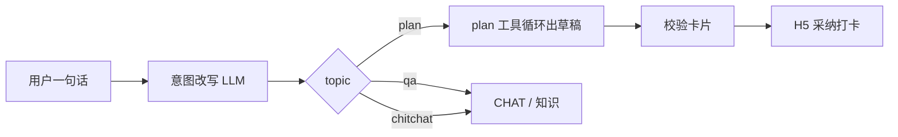

# GymCoach 项目地图

> **唯一台账**（Obsidian 打开本文件即可）。加功能就改这一页，不要再拆多份 md。  
> 范围：本仓 H5 + API。后台 UI 在 `gym-coach-admin`，本 API 的 `/api/admin` 仍记在下面。  
> 评测用例在仓库根目录 `eval/`，不进本文。

---

## 1. 做什么 / 不做什么

**做**：对话出今日计划 → 采纳打卡 → 记录回流；动作库；训练看板；计划模板（H5 浏览 + 后台配置）。

**暂不做**：营养记录/agent、周历排课、用户自建计划、成就皮肤、Vision 纠错、prompt 热更新后台。

---

## 2. 能力一览

| 能力 | 怎么触发 | 状态 |
|---|---|---|
| 出计划 plan | 「今天练胸」等 | ✅ |
| 问答 qa | 动作怎么做 / 建议 / 查自己的数 | ✅ |
| 闲聊 chitchat | 寒暄、不想练 | ✅ |
| 安全停训 | 带伤问练 | ✅ |
| 今日打卡 + 计时 + 1RM | 今日页 | ✅ / 1RM 持续验证 |
| 动作库浏览 | `/exercises` | ✅ |
| 计划模板 H5 | `/plans` → 选板块 expand → adopt | ✅ |
| 计划模板后台 | admin「计划模板」 | ✅ |
| 营养 | — | 📋 未做 |
| 打卡海报 / 生图 | — | 💡 规划中 |

---

## 3. 意图怎么走

代码：`api/app/brain/intent_rewrite.py` → `graph.py`

**一级 topic（模型分）**

| topic | 含义 | 接着谁处理 |
|---|---|---|
| `plan` | 要一份安排（训练/饮食） | 排课路径 |
| `qa` | 解释、建议、查数据 | 聊天/知识 |
| `chitchat` | 都不要 | 聊天短路 |

另有 `domain`：`training | nutrition | general`（只标领域）。  
`qa` 还可带 `qa_kind`：`explain | recall | decide`。

**图路由** `_pick_route`：`clarify | plan | chat | nutrition`（nutrition 仍是占位）。



---

## 4. 模型工具（就这 4 个）

白名单：`brain/tools.py` → `execute_tool`

| 工具 | 干什么 |
|---|---|
| `retrieve_exercises` | 按部位等取候选动作 |
| `get_related_stats` | 读相关历史重量 |
| `get_recent_sets` | 读近期组记录 |
| `submit_training_draft` | 提交草稿结构（不落库） |

落库靠 HTTP：`POST /api/training/adopt` 等，**不是**模型工具。

排课检索核心还有内存目录：`exercises_catalog.retrieve_candidates`。

---

## 5. Prompt 在哪

没有单独 `prompts/` 目录，正文在代码里：

| 名字 | 文件 |
|---|---|
| 意图槽位提取 | `brain/intent_rewrite.py` |
| PLAN 兜底出卡 | `brain/pipeline.py` → `SYSTEM_PROMPT` |
| CHAT 问答 | `brain/pipeline.py` → `CHAT_SYSTEM` |
| 工具循环 | `brain/plan_loop.py` → `PLAN_TOOL_SYSTEM` |
| 知识问答 | `brain/knowledge_reply.py` → `KNOWLEDGE_SYSTEM` |

红线：不编造库外动作；称呼用「你」；伤病要规避；模型改不了系统提示词。

---

## 6. 关键数据口径

| 点 | 事实 |
|---|---|
| 打卡动作键 | `TrainingSetLog.exercise_name`（中文名），**还不是** `exercise_id` |
| 动作库 SKU | `exercises.id`；`roles`=肌群，`slot_roles`=计划槽位，勿混 |
| 计划模板 | `plan_templates` → `plan_blocks` → `plan_exercises`；未发布不进 H5 |
| 场次溯源 | `trainingsession.plan_template_id / plan_block_id / plan_type` |
| 热身组 | `trainingsetlog.is_warmup`，不计入 1RM |

---

## 7. 主要接口（记目录）

- 对话：`/api/chat*` · 评测：`/api/eval/*` · 反馈：`/api/feedback`
- 训练：`/api/training/today|adopt|sets|dashboard|sessions…`
- 动作库：`/api/exercises*`
- 计划：`GET /api/plans` · `GET /api/plans/{id}` · `POST …/expand`
- 画像/登录：`/api/profile*` · `/api/auth*`
- 后台：`/api/admin/exercises*` · `media-pool*` · `plans*`

草稿卡：`card_type=training_draft`，item.meta 含 `sets/reps/weight/muscle/warmup_sets`；模板展开时 meta 可带 `plan_*`。

---

## 8. 评测

根目录 `eval/`：整体 / 意图门禁 / 长对话 三套（见 `eval/README.md`）。  
改提示词建议顺序：意图 → 长对话 → 整体。

---

## 9. 目录速查

```
api/app/brain/     意图、图、计划循环、知识、记忆
api/app/services/  场次、看板、计划、公开库、admin
api/app/routers/   HTTP
web/               H5
eval/              评测（独立）
gym-ui/            设计 tokens（样式规则另见 .cursor/rules）
```

公司机：可用 SQLite + mock LLM，不必装 Postgres。

---

## 10. 怎么维护本页

- **加能力 / 工具 / 表字段 / 接口 / prompt**：在对应小节改一行，状态写清。  
- **进行中的大功能**：写在下面「进行中」，做完勾掉或移到能力表。  
- **不要**再新建 `docs/01.md`、`abilities.md` 平行文档。

### 进行中

- [ ] 营养模块（未开工）
- [ ] 打卡 1RM / 体验类优化（待验证与产品化）
- [x] 计划模板 H5 + 后台配置（主路径已通）
