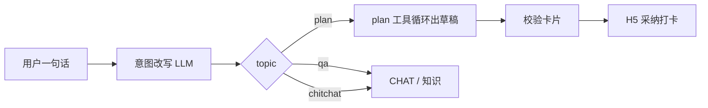

# GymCoach 项目地图

> **唯一台账**（Obsidian 打开本文件即可）。加功能就改这一页，不要再拆多份 md。  
> 范围：本仓 H5 + API。后台 UI 在 `gym-coach-admin`，本 API 的 `/api/admin` 仍记在下面。  
> 评测用例在仓库根目录 `eval/`，不进本文。

---

## 1. 做什么 / 不做什么

**做**：对话出今日计划 → 采纳打卡 → 记录回流；动作库；训练看板；计划模板（H5 浏览 + 后台配置）。

**暂不做**：营养记录/agent、周历排课、用户自建计划、成就皮肤、Vision 纠错、prompt 热更新后台。

---

## 2. 能力一览

| 能力 | 怎么触发 | 状态 |
|---|---|---|
| 出计划 plan | 「今天练胸」等 | ✅ |
| 问答 qa | 动作怎么做 / 建议 / 查自己的数 | ✅ |
| 闲聊 chitchat | 寒暄、不想练 | ✅ |
| 安全停训 | 带伤问练 | ✅ |
| 今日打卡 + 计时 + 1RM | 今日页 | ✅ / 1RM 持续验证 |
| 动作库浏览 | `/exercises` | ✅ |
| 计划模板 H5 | `/plans` → 详情预填动作 → 选板块 expand → adopt | ✅ |
| 计划模板后台 | admin「计划模板」 | ✅ |
| 营养 | — | 📋 未做 |
| 打卡海报 / 生图 | — | 💡 规划中 |

---

## 3. 意图怎么走

代码：`api/app/brain/intent_rewrite.py` → `graph.py`

**一级 topic（模型分）**

| topic | 含义 | 接着谁处理 |
|---|---|---|
| `plan` | 要一份安排（训练/饮食） | 排课路径 |
| `qa` | 解释、建议、查数据 | 聊天/知识 |
| `chitchat` | 都不要 | 聊天短路 |

另有 `domain`：`training | nutrition | general`（只标领域）。  
`qa` 还可带 `qa_kind`：`explain | recall | decide`。

**图路由** `_pick_route`：`clarify | plan | chat | nutrition`（nutrition 仍是占位）。



---

## 4. 模型工具（就这 4 个）

白名单：`brain/tools.py` → `execute_tool`

| 工具 | 干什么 |
|---|---|
| `retrieve_exercises` | 按部位等取候选动作 |
| `get_related_stats` | 读相关历史重量 |
| `get_recent_sets` | 读近期组记录 |
| `submit_training_draft` | 提交草稿结构（不落库） |

落库靠 HTTP：`POST /api/training/adopt` 等，**不是**模型工具。

排课检索核心还有内存目录：`exercises_catalog.retrieve_candidates`。

---

## 5. Prompt 在哪

没有单独 `prompts/` 目录，正文在代码里：

| 名字 | 文件 |
|---|---|
| 意图槽位提取 | `brain/intent_rewrite.py` |
| PLAN 兜底出卡 | `brain/pipeline.py` → `SYSTEM_PROMPT` |
| CHAT 问答 | `brain/pipeline.py` → `CHAT_SYSTEM` |
| 工具循环 | `brain/plan_loop.py` → `PLAN_TOOL_SYSTEM` |
| 知识问答 | `brain/knowledge_reply.py` → `KNOWLEDGE_SYSTEM` |

红线：不编造库外动作；称呼用「你」；伤病要规避；模型改不了系统提示词。

---

## 6. 关键数据口径

| 点 | 事实 |
|---|---|
| 打卡动作键 | `TrainingSetLog.exercise_name`（中文名），**还不是** `exercise_id` |
| 动作库 SKU | `exercises.id`；`roles`=肌群，`slot_roles`=计划槽位，勿混 |
| 计划模板 | `plan_templates` → `plan_blocks` → `plan_exercises`；未发布不进 H5；框架空槽在 `GET /plans/{id}` 预填动作名（`preview_filled`），不展示空壳槽位 |
| 计划场景标签 | `plan_templates.scene_tag`：三分化/四分化/五分化/博主同款/单部位专项/新手入门 |
| 动作行目标肌群 | `plan_exercises.target_muscle`（胸/背/肩/腿/臂/核心）；拆解溯源用 `source_kind` / `match_confidence` / `source_snippet`，**勿塞 `note`** |
| 组间休息 | `plan_exercises.rest_sec`（默认 90） |
| 勾选时刻 | `trainingsetlog.completed_at`（组间休息/视频分析用；历史可空） |
| 周跟练 | `profile.active_plan_id` + `active_plan_started_at`；本周进度由场次推算 |
| 内容工坊任务 | 表 `studio_tasks` + `/api/admin/studio/*` + Admin `/studio`（本地上传可跑通；链接需 yt-dlp；字幕可选 faster-whisper） |
| 场次溯源 | `trainingsession.plan_template_id / plan_block_id / plan_type` |
| 热身组 | `trainingsetlog.is_warmup`，不计入 1RM |
| 默认库文件 | SQLite：`api/data/gym.db`（`DATABASE_URL=sqlite:///./data/gym.db`）；启动 `init_db` 自动 `create_all` + `_ensure_columns` 补列 |

### 6.1 配课 / 换动作判定标准（字段优先，禁止动作名写死）

**原则**：运行时只信结构化字段；加新动作 = 后台填字段，**不改**配课代码。

| 用途 | 信什么 | 不信什么 |
|---|---|---|
| 是否核心动作 | `muscle==核心` 或 `movement_pattern==核心卷曲/稳定` | 名字含「平板/卷腹…」 |
| 槽位 main/assist/isolation | `slot_roles`（有则用之）；空则用 `movement_pattern`+`muscle`+`modality` 推断 | 名字含「夹胸/飞鸟…」 |
| 抽哪块肌 | `PlanExercise.target_muscle`；换动作优先 `item.muscle` 主练一致 | 把 `roles` 协同与主练等权 |
| 推日/拉日「臂」 | `sub_region` 含 `肱三头肌` / `肱二头肌` | 名字含「弯举/下压」长期名单 |

**脏数据怎么治**：去后台改该动作的 `muscle` / `movement_pattern` / `slot_roles` / `sub_region`。名字启发只允许出现在后台「猜分类」工具（`admin_editor._guess_taxonomy`），用来一次性填字段，不是热路径规则。

**夹胸/飞鸟/腿屈伸等孤立**：taxonomy 里若暂无专属 `movement_pattern`，必须在动作上标 `slot_roles=["isolation"]`，勿在 API 里加动作名黑白名单。

**公司机拉代码后怎么看库（可选）**

```bash
cd api
# 启动一次 API 就会自动补列 / 建 studio_tasks
.\.venv\Scripts\python.exe -c "from app.db import init_db; init_db(); print('ok')"
# 只看表结构（SQLite）
.\.venv\Scripts\python.exe -c "from sqlalchemy import inspect; from app.db import engine; i=inspect(engine); print(i.get_table_names()); print([c['name'] for c in i.get_columns('plan_exercises')])"
```

也可用 [DB Browser for SQLite](https://sqlitebrowser.org/) 打开 `api/data/gym.db`。Postgres 则连 `.env` 里的 `DATABASE_URL`。

---

## 7. 主要接口（记目录）

- 对话：`/api/chat*` · 评测：`/api/eval/*` · 反馈：`/api/feedback`
- 训练：`/api/training/today|adopt|sets|dashboard|sessions…`
- 动作库：`/api/exercises*`
- 计划：`GET /api/plans`（`scene` 场景筛）· `GET /api/plans/{id}` · `POST …/expand` · `POST …/follow` · `DELETE /api/plans/follow` · `GET /api/plans/following`
- 画像/登录：`/api/profile*` · `/api/auth*`
- 后台：`/api/admin/exercises*` · `media-pool*` · `plans*` · `POST …/plans/{id}/cover` · `POST …/plan-blocks/{id}/cover`
- 内容工坊：`/api/admin/studio/ingest-batch|tasks*|upload-fallback|retry-download|replace-source|continue|retranscribe|reparse|attach-demo|cover|preview-clip|quick-create-exercise|confirm-plan|cookies|deps`（`attach-demo` 立刻把选区写入动作库示范；`reparse` 用 DeepSeek 重拆）
- 动作 SKU 列表：`GET /api/admin/exercises?sort=updated_desc|name|core`（默认按最新更新）
- 存储：`STORAGE_BACKEND=local|s3`（`api/app/services/storage.py`，默认本地 `/static/{key}`）
- 媒体 URL：`admin_catalog.media_url` 对已是 `/static/…` 的路径原样返回（勿再拼 `/static/exercises/`，否则 H5 示范/封面 404）
- 工坊 `attach-demo`：精确裁切（`-ss` 在 `-i` 后）写入 published `demo` MP4；封面取切片第 0 帧；同步草稿 `cues/mistakes` → SKU `cues_zh` / `common_mistakes_zh`（教案空则用 cues 填 `instructions_zh`）；刷新 `image_start` / `updated_at`
- SKU 详情「删除此素材」= 归档槽位（删动图会带走工坊同源封面）；「保存字段」只存文案/分类；「从 H5 下架」= `is_valid_exercise=false`（H5 搜不到，后台可再上架）
- 工坊清单「从清单删除此项」只改任务草稿，不删 SKU

草稿卡：`card_type=training_draft`，item.meta 含 `sets/reps/weight/muscle/warmup_sets`；模板展开时 meta 可带 `plan_*`。

---

## 8. 评测

根目录 `eval/`：整体 / 意图门禁 / 长对话 三套（见 `eval/README.md`）。  
改提示词建议顺序：意图 → 长对话 → 整体。

---

## 9. 目录速查

```
api/app/brain/     意图、图、计划循环、知识、记忆
api/app/services/  场次、看板、计划、公开库、admin
api/app/routers/   HTTP
web/               H5
eval/              评测（独立）
gym-ui/            设计 tokens（样式规则另见 .cursor/rules）
```

公司机：可用 SQLite + mock LLM，不必装 Postgres。

---

## 10. 怎么维护本页

- **加能力 / 工具 / 表字段 / 接口 / prompt**：在对应小节改一行，状态写清。  
- **进行中的大功能**：写在下面「进行中」，做完勾掉或移到能力表。  
- **不要**再新建 `docs/01.md`、`abilities.md` 平行文档。

### 进行中

- [x] H5 排课质量 + 周跟练 + 今日/计划分类重排 + 静音 LoopClip + R2/本地存储适配
- [ ] H5 页面改版 P0（豆包 1117）：今日 v2 / 我的 v3 / 资料页挂路由 / 训练三入口+分析壳 — **前端骨架已落**；本周条·部位间隔·上次对比·组间休息计时属 P2/P3 待接口
- [x] 内容工坊主路径：`/api/admin/studio/*` + Admin `/studio` 三栏台
- [x] 内容工坊交互稿 UI + LLM 拆口播 + 百分制候选匹配（admin `docs/11`）
- [ ] 内容工坊方案 A：卡片只绑定 / 抽屉要领对比写库（admin `docs/12`；配对接口 + 抽屉 UI 已接，待联调）
- [ ] 营养模块（未开工）
- [ ] 打卡 1RM / 体验类优化（待验证与产品化）
- [ ] 动作视频分析 FormCheck（入口：`/training/form-check` + Recap CTA；管线二期）
- [x] 计划模板 H5 + 后台配置；五分化 seed、奥举降权、孤立槽兜底
